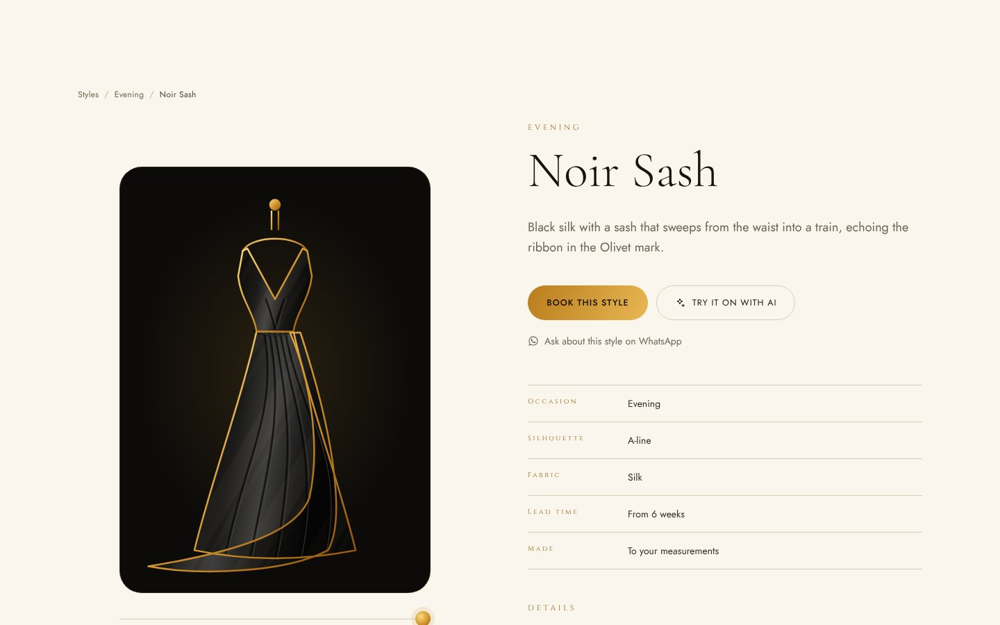
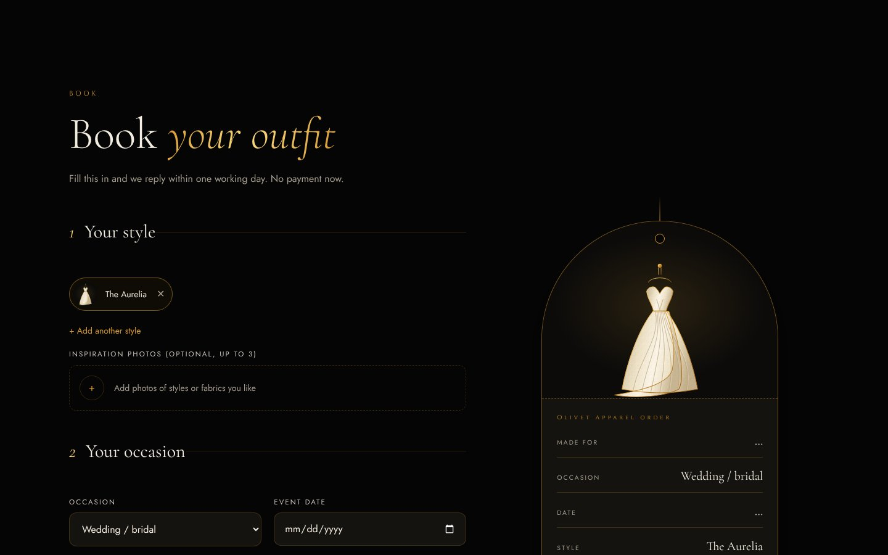
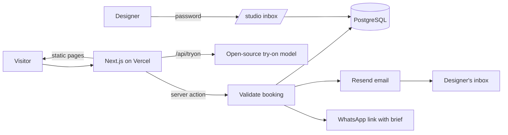

# Olivet Apparel

A portfolio and booking website for **Olivet Apparel**, a custom fashion house in Lagos run by designer Titilayomi. Visitors browse her styles, see how an outfit is made, and send a booking request that reaches her by email and WhatsApp.

**Live site:** https://olivet-apparel.vercel.app

| Light mode | Dark mode |
|---|---|
|  |  |
|  |  |

## The brief

The client wanted a site that makes a visitor think "this designer can make my outfit" and then makes booking easy. It had to feel premium and different from a template, stay simple enough that nobody gets lost, cost nothing to run, and launch before any professional photos existed.

## What I built

- **A clear path to booking.** The home page says what the business is in one sentence, then shows what she makes, how ordering works, and a booking button. Every page is one tap from the booking form or WhatsApp.
- **Styles drawn in code.** With no photography yet, each outfit is an SVG illustration generated from data (silhouette, neckline, fabric, colours). When real photos arrive they replace the drawings one style at a time, with no code changes.
- **Sketch-to-finished slider.** Drag to watch an outfit go from pencil sketch, to fabric, to fitting, to the finished piece. One component, driven by a single progress value.
- **A thread that follows the scroll.** A gold thread leaves the needle in the logo and runs down the page as you scroll, ending at the booking section. It is one SVG path, measured from the layout, with no animation library.
- **Find my style.** Four picture questions match a visitor to styles. The scoring is plain, deterministic code, so it is instant, free and testable.
- **Booking that never loses a lead.** A request is validated on the server, saved to PostgreSQL, emailed to the designer with the client's inspiration photos attached, and handed to WhatsApp with the whole brief pre-typed. Each step still works if the one before it is not configured or fails.
- **Private studio inbox.** A password-protected page where the designer sees requests, updates their status and replies on WhatsApp in one tap.
- **AI try-on, wired and waiting.** A server route proxies an open-source virtual try-on model. It switches on per style once a garment photo is added.
- **Light and dark mode.** The site follows the device setting: black and gold in dark mode, ivory and deep gold in light mode.

## Engineering notes

| Decision | Why |
|---|---|
| **Next.js App Router with Partial Prerendering** | Public pages are static HTML from a CDN. Only the studio inbox and server actions run on demand. |
| **Server Actions for forms** | The booking form posts straight to a server function. No API layer to maintain, and it works before JavaScript loads. |
| **Plain SQL, no ORM** | One table and a handful of parameterised queries. The schema is created on first use, so a new database needs no setup. |
| **Save first, notify second** | The database write happens before the email. An email outage cannot lose a booking, and the WhatsApp hand-off works with no backend at all. |
| **Graceful degradation by configuration** | Database, email, try-on and the studio each switch on with an environment variable. With none set the site still takes bookings. |
| **Semantic design tokens** | Colours are CSS variables (`page`, `card`, `fg`, `muted`, `edge`, `gold`) mapped into Tailwind. Themes swap the variables, so components contain no theme logic. |
| **Images compressed in the browser** | Inspiration photos are resized on a canvas before upload, which keeps the form fast on mobile data and inside serverless limits. |
| **Few dependencies** | Runtime dependencies are Next.js, React, `postgres` and `@gradio/client`. Email goes through a single `fetch` call. |
| **Security basics** | Secrets stay on the server. The studio uses an HMAC-signed, httpOnly cookie with constant-time comparison. Forms have a honeypot, a minimum-time check and strict input allow-lists. |
| **Accessibility** | Semantic HTML, labelled controls, keyboard focus styles, `prefers-reduced-motion` support, and decorative graphics hidden from screen readers. |

## Architecture



## Tech stack

Next.js 16 · React 19 · TypeScript · Tailwind CSS 4 · PostgreSQL · Resend · Vitest · GitHub Actions · Vercel

## Run it locally

```bash
npm install
cp .env.example .env.local   # every variable is optional
npm run dev                  # http://localhost:3000
```

| Command | What it does |
|---|---|
| `npm run dev` | Start the development server |
| `npm run build` | Production build |
| `npm run check` | Lint, type check and run the tests |
| `npm test` | Unit tests only |

## Configuration

The site runs with no environment variables. Each one below switches a feature on.

| Variable | Purpose |
|---|---|
| `NEXT_PUBLIC_WHATSAPP_NUMBER` | WhatsApp number, digits only, international format |
| `NEXT_PUBLIC_PHONE_DISPLAY` | Phone number as displayed |
| `NEXT_PUBLIC_CONTACT_EMAIL`, `NEXT_PUBLIC_INSTAGRAM`, `NEXT_PUBLIC_STUDIO_CITY` | Public contact details |
| `NEXT_PUBLIC_SITE_URL` | Canonical URL, used for SEO and social previews |
| `DATABASE_URL` | PostgreSQL connection string. Enables stored bookings and the studio inbox. |
| `RESEND_API_KEY`, `BOOKING_TO_EMAIL` | Enables booking emails to the designer |
| `EMAIL_FROM` | Verified sender address. Enables confirmation emails to clients. |
| `STUDIO_PASSWORD`, `STUDIO_SECRET` | Enables the private `/studio` inbox |
| `HF_TOKEN`, `TRYON_SPACE` | Optional settings for AI try-on |

## Project structure

```
src/
  app/            Routes, server actions and the try-on API route
  components/     UI, grouped by feature (booking, garment, styles, thread, ...)
  content/        Site settings, styles and fabrics: edit content here
  lib/            Booking validation, SQL, email, auth, style matching, garment geometry
tests/            Unit tests for the pure logic
db/schema.sql     Reference schema (created automatically at runtime)
docs/             Architecture, decisions and roadmap
```

### Adding a style or photos

Styles live in `src/content/looks.ts`. Add an entry to `looks` to create a new style. To use real photos, put them in `public/looks/<slug>/` and list them under `images` with their stage (`sketch`, `fabric`, `fitting`, `final`). Set `tryOnGarment` to a plain photo of the garment to enable AI try-on for that style.

## Testing

`npm test` runs unit tests for the logic that must not break: booking validation and sanitising, reference generation, the style-matching scores, content integrity (every style points at a real collection and fabric) and the garment geometry. CI runs lint, type check, tests and a production build on every push.

## Roadmap

- Replace illustrations with studio photography
- Edit styles from the studio instead of the content file
- Online deposits
- Client testimonials

## Credits

Designed and built by [sthmpe](https://github.com/Sthmpe) for Olivet Apparel, with Claude Code as a pair programmer.
