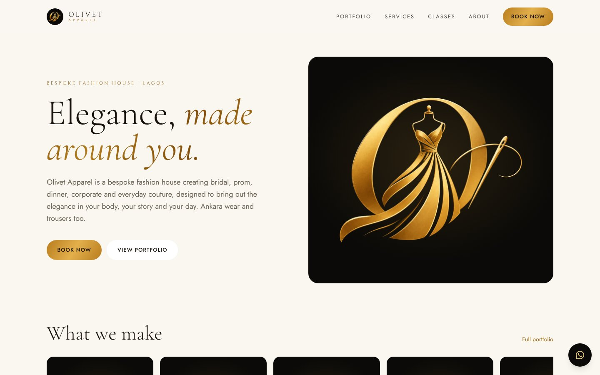
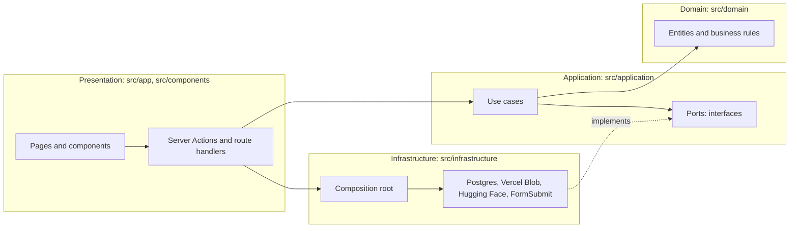

# Olivet Apparel

Website for **Olivet Apparel**, a bespoke fashion house in Lagos run by designer Titilayomi. Clients browse her portfolio by category, book an outfit or a sewing class, and reach her on WhatsApp or by email. She manages her own portfolio photos and incoming requests from a private studio page.

**Live site:** https://olivet-apparel.vercel.app

| Light mode | Dark mode |
|---|---|
|  |  |

## Features

| Area | What it does |
|---|---|
| **Portfolio** | Photo gallery grouped into seven categories: Bridal, Prom, Dinner, Corporate, Everyday, Ankara and Trousers. Filter by category, open any photo full screen, and book that style. |
| **Services** | One section per category with what it includes, plus the four-step ordering process. |
| **Classes** | Sewing courses from Foundation to Advanced, in the studio or online, with prices and an enrol button. |
| **Booking** | One short form for outfits and classes. The request is saved, delivered to the studio inbox for free, and handed to WhatsApp or email with the full brief pre-written. |
| **Studio** | Password-protected page where the designer uploads and deletes portfolio photos and manages requests. |
| **AI try-on** | Visitors upload a photo and preview a portfolio style on themselves, using an open-source model behind a server route. |
| **Theme** | Follows the device setting: black and gold in dark mode, ivory and deep gold in light mode. |

### Portfolio images

The launch portfolio holds 21 AI-generated reference photos of faceless dress forms, three per category, made with Figma AI in one consistent studio style. They show the styles the designer makes and are stored in Vercel Blob like any studio upload, so she can replace them with photos of her own work from the studio page.

## Technology

| Layer | Choice |
|---|---|
| Framework | Next.js 16 (App Router, Server Components, Server Actions, Partial Prerendering, `use cache`) |
| Language | TypeScript (strict) |
| UI | React 19, Tailwind CSS 4, `next/image`, Google Fonts (Cormorant Garamond, Cinzel, Jost) |
| Photo storage | Vercel Blob |
| Database | PostgreSQL through the `postgres` driver, plain parameterised SQL |
| Email | FormSubmit (free, no account), with `mailto:` and WhatsApp fallbacks |
| AI | IDM-VTON on Hugging Face through `@gradio/client` |
| Testing | Vitest |
| CI and hosting | GitHub Actions, Vercel |

## Architecture

The code follows **Clean Architecture** (ports and adapters). Dependencies point inward: business rules know nothing about Next.js, Vercel or Postgres.



| Layer | Folder | Responsibility | Examples |
|---|---|---|---|
| Domain | `src/domain` | Entities and rules as pure functions. No I/O, no framework. | `catalog.ts` categories and photo-path encoding, `booking.ts` validation and the request brief, `courses.ts` |
| Application | `src/application` | Use cases, and the ports (interfaces) they need. | `submitBooking`, `listPortfolio`, `addStudioPhoto`, `BookingRepository`, `FileStorage`, `TryOnService` |
| Infrastructure | `src/infrastructure` | Adapters that implement the ports, and the composition root that picks one per environment. | `PostgresBookingRepository`, `VercelBlobStorage`, `HuggingFaceTryOn`, `container.ts` |
| Presentation | `src/app`, `src/components` | Routes, Server Actions and React components. Thin adapters that call use cases. | `app/book/actions.ts`, `components/portfolio/Gallery.tsx` |
| Content | `src/content` | Editable data: site settings, services, classes. | `site.ts`, `courses.ts` |

Because use cases depend on interfaces, the tests run them against in-memory fakes (`tests/fakes.ts`) with no database or network.

### How the portfolio is categorised

Categories are defined once, in `src/domain/catalog.ts`. A studio upload is stored in Vercel Blob at:

```
portfolio/<category>/<timestamp>-<title-slug>.jpg
```

The path itself carries the category, title and upload time, so the portfolio needs no database. `parseStudioPhotoPath` reads it back, and `listPortfolio` merges uploads (newest first) with any photos shipped in `src/content/catalog.ts`. The listing is cached with `use cache` and refreshed instantly through a cache tag whenever a photo is added or deleted.

### How a booking travels

1. The form posts to a Server Action, which calls the `submitBooking` use case.
2. `validateBookingRequest` checks every field against allow-lists and length limits.
3. Inspiration photos, already compressed in the browser, are saved to Vercel Blob.
4. The request is saved to Postgres when a database is connected.
5. The client sees a confirmation. The browser delivers the request to the studio inbox through FormSubmit, and offers WhatsApp and email buttons carrying the full brief.

Every storage step is optional and isolated: if one fails or is not configured, the client can still send the request.

## Getting started

```bash
npm install
cp .env.example .env.local   # every variable is optional
npm run dev                  # http://localhost:3000
```

| Command | Purpose |
|---|---|
| `npm run dev` | Development server |
| `npm run build` | Production build |
| `npm run check` | Lint, type check and tests |
| `npm test` | Unit tests |

## Configuration

The site runs with no environment variables. Each one switches a feature on.

| Variable | Feature |
|---|---|
| `NEXT_PUBLIC_WHATSAPP_NUMBER`, `NEXT_PUBLIC_PHONE_DISPLAY` | WhatsApp buttons and phone number |
| `NEXT_PUBLIC_CONTACT_EMAIL`, `NEXT_PUBLIC_INSTAGRAM`, `NEXT_PUBLIC_STUDIO_CITY` | Public contact details |
| `NEXT_PUBLIC_SITE_URL` | Canonical URL for SEO and social previews |
| `NEXT_PUBLIC_BOOKING_EMAIL` | Inbox for booking requests through FormSubmit. The first request sends a one-time activation email. |
| `BLOB_READ_WRITE_TOKEN` | Portfolio uploads and inspiration photos. Added by Vercel when a Blob store is connected. |
| `DATABASE_URL` | Request inbox in the studio |
| `STUDIO_PASSWORD`, `STUDIO_SECRET` | The private `/studio` page |
| `HF_TOKEN`, `TRYON_SPACE` | Optional AI try-on settings |

## Project structure

```
src/
  domain/          Business rules: catalog, booking, courses
  application/     Use cases and ports
  infrastructure/  Adapters (Postgres, Vercel Blob, Hugging Face, FormSubmit), auth, composition root
  app/             Routes, Server Actions, API routes
  components/      React components grouped by feature
  content/         Site settings, services, classes
tests/             Domain and use-case tests with in-memory fakes
db/schema.sql      Reference database schema
docs/              Architecture, decisions, roadmap, case study
```

## Quality

- `npm run check` runs ESLint, `next typegen` with `tsc`, and Vitest. GitHub Actions runs it plus a production build on every push.
- Accessibility: semantic HTML, labelled controls, visible focus, keyboard navigation in the photo viewer, reduced-motion support.
- Security: secrets stay on the server; the studio uses an HMAC-signed httpOnly cookie with constant-time comparison; form input is validated against allow-lists; the try-on route only accepts garment images from this site's own storage.

## Credits

Designed and built by [sthmpe](https://github.com/Sthmpe) for Olivet Apparel, with Claude Code as a pair programmer.
